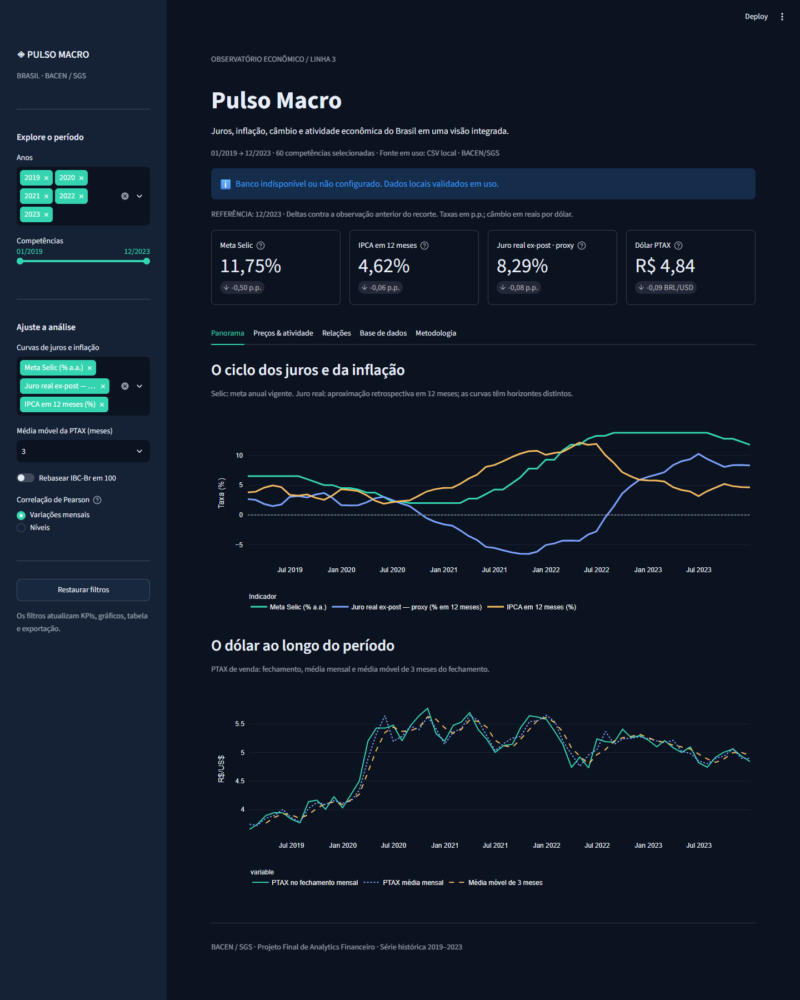

# Pulso Macro — Analytics Financeiro com BACEN / SGS

Dashboard em Python e Streamlit para analisar juros, inflação, câmbio e atividade econômica do Brasil entre **01/01/2019 e 31/12/2023**. Projeto da **Linha 3 — Macroeconomia, Taxas de Juros & Indicadores Econômicos**.

O repositório inclui a base real consolidada em 60 competências e os JSON de origem. O aplicativo pode funcionar sem acesso à API e sem banco configurado. Quando há PostgreSQL disponível e válido, ele tem prioridade; em caso de falha, o aplicativo usa o CSV automaticamente e informa a origem na tela.

[Repositório no GitHub](https://github.com/evelynkleinenf-cloud/pulso-macro-bacen).

[Dashboard hospedado no Streamlit Community Cloud](https://pulso-macro-bacen.streamlit.app/).



## Execução local

Use Python **3.11 a 3.14** e execute os comandos **na raiz do projeto**. Não é necessário mover ou editar caminhos no código.

```powershell
python -m venv .venv
.\.venv\Scripts\python.exe -m pip install -r requirements.txt
.\.venv\Scripts\python.exe -m streamlit run app.py
```

No Linux/macOS, substitua `.\.venv\Scripts\python.exe` por `.venv/bin/python`. Abra a URL local informada pelo Streamlit, normalmente `http://localhost:8501`.

**Primeira demonstração:** abra o aplicativo sem criar `secrets.toml`. O aviso de uso do CSV é esperado e mostra a contingência funcionando. A API pública do SGS não exige chave.

## Estrutura

```text
meu-projeto-financeiro/
├── .github/workflows/ci.yml
├── .streamlit/
│   ├── config.toml
│   └── secrets.toml.example
├── data/
│   ├── raw/sgs_*.json
│   ├── macro_mensal.csv
│   └── metadata.json
├── docs/
│   └── dashboard.png
├── notebooks/
│   └── eda_exploratoria.ipynb
├── src/
│   ├── __init__.py
│   ├── config.py
│   ├── etl.py
│   ├── database.py
│   ├── analytics.py
│   └── charts.py
├── tests/
│   ├── test_pipeline.py
│   └── test_app.py
├── .gitignore
├── app.py
├── pyproject.toml
├── requirements.txt
├── requirements-dev.txt
└── README.md
```

`config.py` centraliza códigos SGS e caminhos relativos. `etl.py` extrai, valida, consolida e salva os dados. `database.py` gerencia PostgreSQL e fallback. `analytics.py` concentra contratos, cálculos, filtros e exportação. `charts.py` cria as figuras em Plotly Express. `app.py` compõe a interface. O notebook reaproveita os módulos para manter a metodologia consistente.

## ETL reprodutível

```powershell
# Atualizar com a API oficial: requer internet
.\.venv\Scripts\python.exe -m src.etl

# Reprocessar exatamente o snapshot incluído: não requer internet
.\.venv\Scripts\python.exe -m src.etl --use-raw
```

A extração usa HTTPS, timeouts e até três novas tentativas para falhas transitórias e respostas 429/5xx. As consultas são divididas em intervalos anuais, respeitando a restrição de até dez anos das séries diárias do SGS. Datas e valores são convertidos explicitamente; duplicatas, ausências e competências inválidas impedem a publicação. Não se substituem falhas por dados simulados.

Os arquivos finais só são escritos depois da validação das cinco séries. Cada arquivo é substituído por operação atômica. `metadata.json` registra horário UTC da geração, códigos, metodologia, contagens e SHA-256 do CSV. O hash permite verificar o snapshot; não constitui assinatura digital da fonte. As séries do BACEN podem sofrer revisões, por isso uma nova extração pode alterar o histórico.

O cache `@st.cache_data(ttl=3600)` cobre consultas, leitura, conversão, consolidação, validação, filtros, correlação e serialização de CSV. Rotinas de escrita não são cacheadas, para que seus efeitos sejam executados em cada chamada. A versão do arquivo local participa da chave de cache. O fallback não impede uma nova tentativa de banco no próximo rerun; consultas bem-sucedidas permanecem em cache por uma hora.

## Fontes e frequência

| SGS | Indicador | Frequência de origem | Consolidação mensal |
|---|---|---|---|
| 432 | Meta Selic | Diária, % a.a. | Última observação do mês |
| 433 | IPCA mensal | Mensal, % a.m. | Valor da competência |
| 13522 | IPCA acumulado em 12 meses | Mensal, % | Valor da competência |
| 1 | Dólar PTAX de venda | Diária, R$/US$ | Última observação e média das observações do mês |
| 24364 | IBC-Br com ajuste sazonal | Mensal, índice SGS | Valor da competência |

As competências usam o último dia do mês. Essa data **não é a data de divulgação**, e não se deve usar esta base para backtesting sem considerar defasagens de publicação e revisões. A Selic possui histórico auxiliar desde dezembro/2017; a base analítica entregue continua restrita a janeiro/2019–dezembro/2023.

Dados: [Catálogo oficial BACEN](https://dadosabertos.bcb.gov.br/), [API SGS — exemplo da série 433](https://api.bcb.gov.br/dados/serie/bcdata.sgs.433/dados?formato=json&dataInicial=01/01/2019&dataFinal=31/12/2023), [metadados oficiais do IBC-Br 24364](https://www3.bcb.gov.br/sgspub/consultarmetadados/consultarMetadadosSeries.do?method=consultarMetadadosSeriesInternet&hdOidSerieSelecionada=24364).

### Juro real ex-post: aproximação e limite dos dados

A série 432 informa a **meta**, não a Selic overnight efetivamente realizada. Para evitar comparar apenas a taxa terminal com a inflação passada, calcula-se uma aproximação retrospectiva:

1. Para cada dia dos últimos 12 meses, mantém-se a última meta conhecida, inclusive em fins de semana e feriados.
2. Converte-se a meta em fator diário pela convenção ACT/365: `(1 + meta/100) ** (1/365)`.
3. Acumulam-se os fatores diários na janela de 12 meses, incluindo o dia final e excluindo a data-limite do ano anterior. Anos bissextos preservam seus 366 dias.
4. Aplica-se Fisher com o IPCA oficial de 12 meses:

```text
selic_acumulada_12m = 100 × (produto dos fatores diários − 1)
juro_real_ex_post = 100 × [(1 + selic_acumulada_12m/100) / (1 + ipca_12m/100) − 1]
```

O indicador aparece como **proxy** na interface e no notebook. Não é retorno efetivo de investimento nem medida exata do juro real realizado. Uma medida baseada na Selic efetiva exigiria uma série adicional, fora das cinco especificadas. A meta Selic exibida no gráfico segue em % a.a. vigente; o juro real aproxima o resultado retrospectivo de 12 meses.

### Câmbio, atividade e correlação

A média mensal da PTAX é calculada apenas sobre as observações publicadas, sem preencher feriados. A média móvel é aplicada aos fechamentos mensais dentro do recorte; exige a janela completa de 3, 6 ou 12 meses e não atravessa anos omitidos.

O IBC-Br 24364 já tem ajuste sazonal. O botão de rebaseamento coloca o primeiro mês selecionado em 100 somente para a figura. O índice não substitui o PIB. A variação mensal é calculada antes dos filtros; janeiro/2019 fica vazio por não haver dezembro/2018 na base analítica final.

O heatmap oferece níveis ou variações mensais. Nas variações, taxas usam diferenças em p.p.; câmbio e atividade usam variações percentuais. As transformações precedem os filtros para preservar o mês anterior correto. Pearson exige pelo menos três pares válidos e séries com variância positiva. A correlação contemporânea não prova causalidade e pode ser influenciada por tendências, defasagens e variáveis omitidas.

## PostgreSQL e segredos

O aplicativo utiliza [`st.connection("postgresql", type="sql")`](https://docs.streamlit.io/develop/api-reference/connections/st.connection). As credenciais são obtidas exclusivamente via `st.secrets`.

```powershell
Copy-Item .streamlit/secrets.toml.example .streamlit/secrets.toml
```

Preencha os campos com as credenciais do seu banco. O exemplo habilita SSL com `sslmode = "require"`; use as opções TLS recomendadas pelo provedor, incluindo certificado e verificação de identidade quando disponíveis. Não coloque senhas no código, no notebook, no CSV ou no README. O `.gitignore` exclui o arquivo real e permite apenas o exemplo sem valores sensíveis.

### Supabase como banco principal

O modelo de segredos está preparado para PostgreSQL no Supabase. No projeto Supabase, abra **Connect → Session pooler** e copie o host, a porta e o usuário exibidos. Use o banco `postgres` e a senha do banco definida na criação do projeto. Essa senha é diferente das chaves de API `anon`, `publishable` ou `service_role`.

O Session Pooler atende conexões IPv4 na porta `5432`. O usuário padrão nesse modo segue o formato `postgres.REFERENCIA_DO_PROJETO`; o host deve ser copiado do painel, porque não pode ser deduzido apenas pela região. O aplicativo mantém `st.connection("postgresql", type="sql")`, `st.secrets`, SSL obrigatório e o fallback CSV.

O banco deste projeto foi provisionado no Supabase em **30/10/2026**, com o nome **pulso-macro-bacen**, na região **South America (São Paulo)**, em uma organização Free. A conexão real pelo Session Pooler foi validada com TLS, os 60 meses do CSV foram carregados e conferidos com a tabela `public.indicadores_macro`, e o RLS foi confirmado como habilitado. As credenciais ficam no arquivo privado `.streamlit/secrets.toml` e nos Secrets da hospedagem, fora do GitHub.

O limite de cinco segundos é aplicado com `SET LOCAL statement_timeout` no início de cada transação SQLAlchemy. Isso mantém o limite efetivo mesmo quando o pooler não preserva opções de inicialização da conexão. Um teste real confirmou o cancelamento de uma consulta lenta e a recuperação da conexão para a carga e leitura seguintes.

[Abrir o projeto no painel Supabase](https://supabase.com/dashboard/project/vzmmxvxuuvgclactldvm).

[Captura do dashboard usando PostgreSQL como fonte principal](docs/dashboard-supabase.png).

Referência: [Conexões PostgreSQL e Session Pooler — documentação oficial Supabase](https://supabase.com/docs/guides/database/connecting-to-postgres).

Após configurar um banco do projeto:

```powershell
.\.venv\Scripts\python.exe -m src.etl --use-raw --to-db
```

A rotina cria `indicadores_macro` se necessário e executa UPSERT pela chave primária `data`, dentro de uma transação. Reexecutar não duplica competências. A carga requer permissão de criação/escrita nessa tabela. Para servir o dashboard, prefira um usuário com acesso apenas de leitura.

A consulta do aplicativo tem parâmetros de data, cache de uma hora, limite de conexão de cinco segundos e limite de execução de cinco segundos por comando. Falhas de conexão, de credenciais, de consulta ou de qualidade da tabela acionam o CSV. Mensagens técnicas com credenciais não são exibidas na interface. Ao implantar em outro ambiente, configure os segredos desse ambiente e valide novamente a conectividade com o Supabase.

No Streamlit Community Cloud, selecione `app.py` como entrada e copie o conteúdo do arquivo de segredos para as configurações de Secrets do aplicativo. Versione o CSV de contingência junto com o código. Nunca envie o arquivo real de segredos ao GitHub.

### Hospedagem no Streamlit Community Cloud

O app está vinculado ao repositório `evelynkleinenf-cloud/pulso-macro-bacen`, branch `master`, com entrada em `app.py` e Python 3.14. Os Secrets do Supabase são configurados na hospedagem, separados do código versionado. O endereço escolhido é `https://pulso-macro-bacen.streamlit.app/`.

A validação online confirmou os 60 meses com PostgreSQL como fonte, quatro KPIs, seis gráficos, alteração de filtros e restauração. O download do recorte de 2020 a 2023 foi conferido com 48 linhas e dez colunas. [Captura do painel online](docs/dashboard-online.png).

O PyArrow está fixado em `24.0.0` para manter o ambiente local e o CI alinhados à versão utilizada pela hospedagem, evitando depender de uma substituição automática durante o deploy. Referência técnica: [Apache Arrow — inicialização em threads no Streamlit](https://github.com/apache/arrow/issues/50471).

O acesso de visitantes é definido em **App settings → Sharing**. A visibilidade do app é independente da visibilidade do repositório; manter o código privado permite controlar o acesso do avaliador ao GitHub separadamente do acesso ao dashboard.

## Interface e critérios de avaliação

| Critério | Implementação | Como demonstrar |
|---|---|---|
| ETL | API oficial, retries, tipos, frequência mensal, contrato e proveniência | Executar `python -m src.etl --use-raw` e inspecionar metadados |
| Streamlit | Filtros reativos por ano e competência, estado de sessão e reset | Selecionar 2020, reduzir a janela e restaurar |
| KPIs | Selic, IPCA 12m, juro real ex-post proxy e PTAX, todos com deltas | Alterar o recorte e conferir a última competência |
| Plotly Express | Juros, câmbio com médias, dispersão, IBC-Br, heatmap e barras de IPCA | Explorar as três abas analíticas |
| Resiliência | PostgreSQL primeiro; fallback CSV validado | Abrir sem segredos e observar a indicação da fonte |
| Exportação | CSV da base filtrada, UTF-8 BOM, separador `;` e decimal `,` | Selecionar um ano, baixar e conferir 12 linhas |
| Arquitetura | Módulos separados, caminhos relativos, cache e configuração pública | Revisar `src/`, `app.py` e os testes |
| EDA | Notebook com qualidade, estatística, gráficos e interpretação | Executar todas as células na ordem |
| Git | Repositório, commit inicial, `.gitignore`, instruções e CI | Consultar o histórico e registrar as próximas mudanças em commits reais |

Os deltas comparam a última observação selecionada à anterior selecionada: taxas em pontos percentuais, PTAX em R$/US$. Um único mês não possui delta. Ao selecionar anos não consecutivos, os gráficos preservam lacunas e o cálculo de variações usa a base mensal completa. Séries constantes ou recortes curtos demais recebem mensagens de orientação no heatmap.

## Testes e qualidade

```powershell
.\.venv\Scripts\python.exe -m pip install -r requirements-dev.txt
.\.venv\Scripts\python.exe -m pytest
.\.venv\Scripts\python.exe -m ruff check app.py src tests
.\.venv\Scripts\python.exe -m ruff format --check app.py src tests
```

Os testes verificam os 60 meses, valores históricos conhecidos, reprocessamento a partir dos JSON, capitalização em ano bissexto, fórmula de Fisher, rejeição de bases inválidas, exportação, filtros, lacunas, correlação, prioridade do banco e contingência. O AppTest do Streamlit verifica KPIs, seis gráficos, mudança de anos, reset, seleção vazia e um único mês. Os testes rodam sem API nem banco remoto; o caminho de integração com um servidor PostgreSQL real é uma validação adicional do ambiente de implantação.

A carga SQL também é exercitada com SQLite em memória para verificar o UPSERT compartilhado, atualizações e ausência de duplicatas, sem substituir a validação do driver PostgreSQL. A validação local foi feita com Python 3.14.3; o CI está configurado para Python 3.11 e 3.14. As dependências diretas têm versões fixadas, com uma faixa compatível de NumPy para Python 3.11.

O workflow de CI executa esses checks no GitHub a cada push e pull request. Para abrir o notebook, selecione o interpretador `.venv` no VS Code/Jupyter e execute todas as células. Ele aceita execução a partir da raiz ou da pasta `notebooks`, sempre com caminhos relativos.

## Git e entrega

O projeto não deve incluir segredos, `.venv` ou caches. Antes de publicar:

O `.gitattributes` padroniza as quebras de linha dos arquivos de código e documentação. O CSV de contingência preserva seus bytes originais para que o SHA-256 registrado nos metadados continue válido após clones no Windows ou no Linux.

```powershell
git status --short
git check-ignore .streamlit/secrets.toml
git add .gitattributes .gitignore .streamlit/config.toml .streamlit/secrets.toml.example
git add app.py src data docs notebooks tests requirements.txt requirements-dev.txt pyproject.toml README.md .github
git diff --cached --stat
git commit -m "feat: adiciona analytics macroeconômico BACEN com ETL e dashboard"
git log --oneline
```

Faça novos commits para mudanças reais, com mensagens que expliquem o resultado. Configure o remoto do seu repositório e envie o histórico quando estiver pronto. O avaliador considera a evolução efetiva: arquivos e instruções não substituem o histórico de commits, e a nota depende da rubrica oficial.

Roteiro de apresentação: explique a pergunta de negócio, mostre a origem BACEN e a consolidação mensal, altere os filtros, interprete os quatro KPIs, apresente os seis gráficos com suas limitações, exporte um recorte, demonstre o fallback e encerre com arquitetura, notebook e histórico Git.
