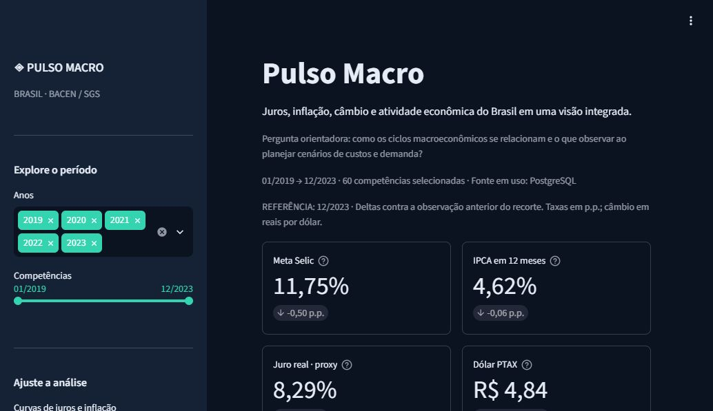
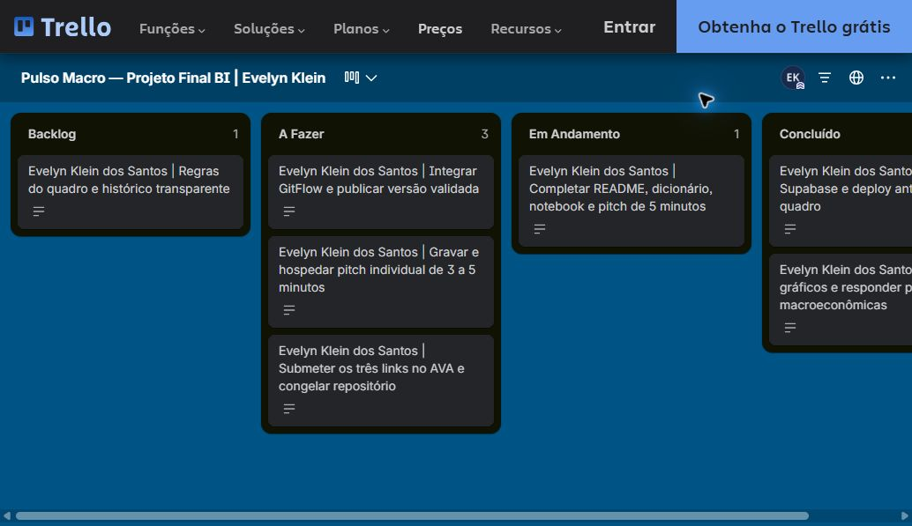

# Pulso Macro — Analytics Financeiro BACEN / SGS

Aplicação da **Linha 3 — Inteligência Macroeconômica e Indicadores Financeiros**, com cinco séries oficiais do Banco Central, consolidadas em **60 competências de janeiro/2019 a dezembro/2023**. O painel relaciona juros, inflação, câmbio e atividade para apoiar planejamento de cenários de custos, receitas e demanda.

**Responsável acadêmica:** Evelyn Klein dos Santos.

| Acesso | Link |
|---|---|
| Aplicação pública | [Pulso Macro no Streamlit](https://pulso-macro-bacen.streamlit.app/) |
| Código e histórico | [GitHub](https://github.com/evelynkleinenf-cloud/pulso-macro-bacen) |
| Gestão individual | [Trello público](https://trello.com/b/zkvMJBOe/pulso-macro-projeto-final-bi-evelyn-klein) |
| Vídeo individual de 3–5 minutos | **Pendente de gravação e envio da URL pela autora** |
| LinkedIn da autora | [Evelyn Klein dos Santos](https://www.linkedin.com/in/evelyn-klein-993228158/) |

A versão de entrega fica em `main`; `develop` integra funcionalidades. A branch `master` é preservada e sincronizada com a versão aprovada para manter a implantação existente no Streamlit. Consulte o histórico de PRs para verificar integrações reais.



## 1. Contexto de negócio e perguntas orientadoras

Uma equipe financeira precisa observar o ambiente macroeconômico ao testar cenários de financiamento, exposição ao dólar e demanda. O desafio é conciliar séries de frequências diferentes, manter cálculos auditáveis e evitar interpretações causais indevidas.

**Pergunta central:** como os ciclos de juros, inflação, câmbio e atividade se relacionam entre 2019 e 2023, e quais sensibilidades um gestor deve acompanhar?

O app responde às cinco perguntas oficiais na aba **Respostas de negócio**:

1. Como evoluiu a meta Selic e quando o juro real ex-post aproximado foi maior?
2. Em quais janelas a PTAX superou a média histórica do quinquênio?
3. A desvalorização cambial se associa à inflação em meses posteriores?
4. Como o IBC-Br se comportou nos ciclos de alta e corte de juros?
5. Quais pares apresentaram os maiores coeficientes de Pearson?

## 2. Fontes, período e licença dos dados

Origem: **Banco Central do Brasil / Sistema Gerenciador de Séries Temporais (SGS)**, API pública HTTPS, sem chave. O IPCA é produzido pelo IBGE e distribuído no SGS. O snapshot está em `data/raw/`; `data/metadata.json` registra extração, metodologia, contagens e SHA-256 do CSV.

| SGS | Indicador | Origem | Consolidação mensal |
|---|---|---|---|
| 432 | Meta Selic, % a.a. | Diária | Último registro do mês |
| 433 | IPCA mensal, % a.m. | Mensal | Competência original |
| 13522 | IPCA acumulado em 12 meses, % | Mensal | Competência original |
| 1 | Dólar PTAX de venda, R$/US$ | Diária | Fechamento e média das observações do mês |
| 24364 | IBC-Br com ajuste sazonal, índice SGS | Mensal | Competência original |

O recorte final é **01/01/2019–31/12/2023**; as datas das linhas identificam o último dia da competência. A Selic possui histórico auxiliar desde dezembro/2017 para calcular as janelas retrospectivas de 2019. Isso não amplia o recorte final entregue.

**Licenças e atribuição:** as fichas oficiais disponíveis no catálogo para [SGS 432](https://dadosabertos.bcb.gov.br/dataset/432-taxa-de-juros---meta-selic-definida-pelo-copom), [SGS 1](https://dadosabertos.bcb.gov.br/dataset/1-taxa-de-cambio---livre---dolar-americano-venda---diario) e [SGS 24364](https://dadosabertos.bcb.gov.br/dataset/24364-indice-de-atividade-economica-do-banco-central-ibc-br---com-ajuste-sazonal) identificam **Open Data Commons Open Database License (ODbL)**, conforme consulta em 30/10/2026. Atribuição: Banco Central do Brasil / SGS; IPCA: IBGE. Na consulta ao catálogo por código, não foram retornadas fichas específicas para 433 e 13522; não se presume uma licença diferente ou equivalente sem confirmação. Para essas séries, consulte os metadados SGS e a [fonte oficial IPCA/IBGE](https://www.ibge.gov.br/estatisticas/economicas/precos-e-custos/9256-ipca.html), preservando atribuição e condições da fonte. Este projeto não altera a licença dos dados originais.

Fontes adicionais: [portal BACEN](https://dadosabertos.bcb.gov.br/), [metadados IBC-Br 24364](https://www3.bcb.gov.br/sgspub/consultarmetadados/consultarMetadadosSeries.do?method=consultarMetadadosSeriesInternet&hdOidSerieSelecionada=24364), [exemplo da API SGS](https://api.bcb.gov.br/dados/serie/bcdata.sgs.433/dados?formato=json&dataInicial=01/01/2019&dataFinal=31/12/2023).

## 3. Pipeline de engenharia e modelagem

1. **Extração:** `requests`, HTTPS, timeouts, até três novas tentativas para 429/5xx e consultas anuais para respeitar as janelas da API diária.
2. **Parsing:** JSON UTF-8, datas explícitas, vírgula decimal convertida, tipos numéricos e rejeição de duplicatas/valores inválidos.
3. **Harmonização:** calendário mensal comum; fechamento para Selic/PTAX, média mensal adicional da PTAX e competência original para inflação/atividade.
4. **Cálculos:** capitalização diária retrospectiva da meta, Fisher, variação mensal do IBC-Br e análises de associação/ciclos.
5. **Validação:** exatamente 60 competências, datas únicas e mensais, indicadores-base completos e finitos. O primeiro crescimento mensal do IBC-Br é ausente porque dezembro/2018 não integra a base final; não é substituído por zero.
6. **Persistência:** JSON originais e CSV publicados após validação, com substituição atômica de cada arquivo. No Supabase, tabela `indicadores_macro`, chave primária `data` e UPSERT transacional sem duplicar competências.
7. **Consumo:** banco prioritário; em erro de conexão, consulta ou contrato, CSV local validado pelo mesmo código.

**Modelo analítico:** uma linha por competência mensal, chave `data`, sete medidas-base e dois derivados. A tabela mensal é adequada à comparação temporal das cinco séries; não contém dados pessoais nem registros de clientes.

```powershell
# Reproduzir o snapshot sem consultar a API
python -m src.etl --use-raw
# Atualizar a partir da API oficial
python -m src.etl
# Publicar os dados validados no banco configurado
python -m src.etl --use-raw --to-db
```

Uma nova extração pode refletir revisões históricas do BACEN e mudar os valores e o hash. As transformações compartilhadas evitam divergência entre ETL, notebook e dashboard.

## 4. Dicionário de dados

No CSV, `data` é texto ISO `YYYY-MM-DD`, convertido para datetime na leitura; na tabela PostgreSQL é `DATE`. As demais medidas são números reais (`float64` no tratamento; `DOUBLE PRECISION` no banco).

| Coluna | Tipo no tratamento | Significado / unidade | Regra |
|---|---|---|---|
| `data` | datetime | Competência mensal | Último dia do mês; não é data de divulgação |
| `selic` | float64 | Meta Selic, % a.a. | Último valor da SGS 432 no mês |
| `ipca_mensal` | float64 | Inflação mensal, % a.m. | SGS 433, sem interpolação |
| `ipca_12m` | float64 | Inflação acumulada em 12 meses, % | SGS 13522; valor oficial |
| `dolar` | float64 | PTAX de venda no fechamento, R$/US$ | Última observação mensal da SGS 1 |
| `dolar_media` | float64 | PTAX média mensal, R$/US$ | Média das observações diárias publicadas; sem preencher feriados |
| `ibc_br` | float64 | Atividade com ajuste sazonal, índice SGS | SGS 24364; escala original preservada |
| `selic_acumulada_12m` | float64 | Retorno nominal aproximado pela meta em 12 meses, % | Produto diário de `(1 + meta/100)^(1/365)` na janela anterior de 12 meses |
| `juro_real_ex_post` | float64 | Juro real retrospectivo aproximado, % em 12 meses | `100 * ((1 + selic_acumulada_12m/100) / (1 + ipca_12m/100) - 1)` |
| `ibc_br_variacao_mensal` | float64, aceita nulo inicial | Crescimento mensal do índice, % | `100 * (IBC_t / IBC_(t-1) - 1)`; primeiro mês sem base anterior |

A data e as colunas-base não admitem nulos. Derivados são recalculados após a leitura do banco ou CSV. Taxas de IPCA negativas são permitidas; câmbio e atividade precisam ser positivos.

## 5. Tecnologias e justificativas

| Tecnologia | Aplicação e motivo |
|---|---|
| Python | Integração do pipeline, cálculos, testes e aplicação |
| Pandas e NumPy | Calendário, tipos, operações vetoriais, capitalização e estatística |
| Requests | API SGS com timeout e política finita de novas tentativas |
| PostgreSQL / Supabase | Persistência centralizada, SQL parametrizado e UPSERT por competência |
| SQLAlchemy e psycopg | Conexão PostgreSQL e transações; limite por comando |
| Streamlit | Estado de sessão, widgets, abas, cache, SQL connection e deploy |
| Plotly Express / Graph Objects | Figuras interativas; composição das barras e linhas do gráfico oficial |
| PyArrow | Serialização tabular; versão 24.0.0 alinhada à hospedagem |
| Jupyter / nbformat | Análise exploratória executada e reprodutível |
| Pytest / Streamlit AppTest | Contratos, fórmulas, calendário, fallback e interação |
| Ruff / GitHub Actions | Lint, formatação e validação em Python 3.11 e 3.14 |
| Git / GitHub / Trello | Histórico das alterações, revisão por PR e Kanban individual |

Dependências diretas em `requirements.txt`; ferramentas de qualidade em `requirements-dev.txt`. A faixa de NumPy para Python 3.11 respeita a compatibilidade dessa versão.

## 6. Resultados e evidências numéricas

Resultados do snapshot incluído, não projeções. Todos podem ser conferidos no notebook e na aba Respostas de negócio.

| Pergunta oficial | Evidência do recorte completo | Interpretação e uso |
|---|---|---|
| Juros e maior juro real | Selic: 6,50% em jan/2019, 2,00% no fim de 2020, 13,75% no fim de 2022 e 11,75% no fim de 2023. Maior juro real proxy: **10,22% em jun/2023**; negativo em **22 de 60 meses**. | Comparar regimes de custo de capital, preservando a diferença entre meta vigente e retorno retrospectivo. |
| PTAX acima da média | Média dos 60 fechamentos: **R$ 4,9434**. Acima dela: **38 meses**, nas janelas mar/2020–fev/2022, jun/2022–mai/2023 e set/2023–out/2023. | Referência histórica para testes de sensibilidade cambial, não previsão de cotação. |
| Desvalorização e inflação posterior | Entre Δ PTAX (%) no mês t e IPCA mensal em t+k: r = **-0,169** em k=0 (59 pares), **-0,327** em k=1 (58) e **0,184** em k=6 (53). O maior módulo entre k=0–6 ocorre em k=1. | Sinais dependem da defasagem e das transformações. Não há identificação de efeito causal ou teste de significância; a seleção exploratória de |r| exige cautela. |
| Atividade nos ciclos de juros | No ciclo iniciado por altas, mar/2021–jul/2023, incluindo manutenção da meta: Selic de 2,00% para 13,75%; IBC-Br **+4,24%**, base fev/2021. No corte ago–dez/2023: Selic de 13,75% para 11,75%; IBC-Br **+1,94%**, base jul/2023. | A coexistência de alta de juros e crescimento não mede a reação causal da atividade. Choques e defasagens não são isolados. |
| Maiores correlações | Em variações mensais: Δ IPCA mensal × Δ IPCA 12m: **r=0,379**; Δ PTAX × Δ IBC-Br: **r=-0,337**; 59 pares. Ranking por |r| preserva o sinal. | Priorizar relações para investigação. Os dois indicadores de inflação compartilham informações por construção; não são evidências independentes de causalidade. |

O IPCA em 12 meses atingiu **12,13% em abr/2022** e terminou 2023 em **4,62%**. Entre os fechamentos jan/2019 e dez/2023, a PTAX variou **+32,57%** e o IBC-Br **+8,19%**, segundo o snapshot revisável.

## 7. Discussão, estatística e limitações

- **Juro real:** a SGS 432 é a meta, não a Selic overnight realizada. A proxy capitaliza a meta vigente diariamente em ACT/365 nos 12 meses anteriores e deflaciona pelo IPCA oficial. Incluem-se os 366 dias de anos bissextos. Não representa retorno efetivo de carteira.
- **Câmbio:** a média histórica é a média aritmética dos 60 fechamentos, fixa sob filtros. É diferente da média das observações diárias do mês e da média móvel, que exige a janela completa e respeita lacunas.
- **Defasagens:** correlaciona-se `100*(PTAX_t/PTAX_(t-1)-1)` ao IPCA mensal em `t+k`, k=0–6. O shift usa o calendário completo antes do filtro; ambas as competências devem pertencer à seleção. Exigem-se 12 pares e variância nas duas séries. Não se calculam p-valores nem se controlam autocorrelação, sazonalidade, múltiplas comparações ou fatores omitidos.
- **Ciclos:** a direção da última mudança mensal da Selic define alta/corte, incluindo manutenção. O IBC-Br compara o fim ao fechamento anterior ao começo da janela; na primeira competência, a base é jan/2019. Lacunas nos filtros separam janelas.
- **Pearson:** o heatmap e ranking oferecem níveis ou variações. Nas variações, taxas usam diferenças em pontos percentuais; câmbio/IBC usam variações percentuais. Séries constantes são excluídas; exigem-se três pares. Correlações de níveis podem refletir tendências comuns.
- **Tempo e revisões:** a competência não é a data da divulgação. Os dados foram extraídos em 2026 e são revisáveis; não reproduzem o que um agente conhecia em cada mês de 2019–2023. Não usar para backtesting sem dados por data de publicação/versão.
- **Atividade:** IBC-Br é uma proxy de atividade, não substitui o PIB. Rebasear em 100 altera somente a escala da figura.

## 8. Aplicação profissional e decisões apoiadas

| Situação gerencial | Como usar | Próxima ação do gestor |
|---|---|---|
| Planejamento de financiamento | Comparar regimes de Selic e juro real | Simular cenários na estrutura real de dívida, com prazos e indexadores da empresa |
| Exposição a receitas/insumos em dólar | Observar fechamento, referência histórica e janelas acima da média | Quantificar a exposição líquida e testar sensibilidades de margem |
| Orçamento e demanda | Ler os ciclos de juros junto ao IBC-Br | Confrontar com vendas, carteira de pedidos e indicadores setoriais próprios |
| Investigação de repasse cambial | Examinar associações com defasagens e número de pares | Formular hipótese para modelo com controles; não converter correlação diretamente em previsão |

O painel apoia exploração e priorização de cenários; não define políticas de crédito, hedge ou investimento automaticamente.

## 9. Demonstração e guia de navegação

1. Abra o [dashboard](https://pulso-macro-bacen.streamlit.app/) e confira competência/fonte ativa.
2. Observe quatro KPIs em duas linhas para preservar legibilidade. Os deltas comparam as duas últimas observações selecionadas; taxas em p.p. e câmbio em R$/US$.
3. Filtre anos e competências na lateral. Anos omitidos mantêm lacunas; recorte de um mês não apresenta delta.
4. Em Panorama, veja Selic/IPCA em linhas, juro real em barras e PTAX com média histórica horizontal.
5. Em Preços & atividade, explore IBC-Br e IPCA mensal; em Relações, veja a dispersão PTAX × IPCA 12m (cor por ano, tamanho pela Selic) e o heatmap.
6. Em Respostas de negócio, confira os cinco resultados, janelas, defasagens, ciclos e ranking.
7. Em Base de dados, baixe o CSV filtrado (`;`, decimal `,`, UTF-8 BOM). Restaure os filtros no botão lateral.
8. Em Metodologia, consulte cálculos, fontes e proveniência do snapshot.

Há **sete gráficos** no recorte completo, seis abas e quatro KPIs. Seleções curtas podem reduzir gráficos estatisticamente indefinidos, com mensagens de orientação.

## 10. Execução local e configuração segura

Use Python 3.11 a 3.14. Execute na raiz do clone, sem caminhos pessoais absolutos.

```powershell
git clone https://github.com/evelynkleinenf-cloud/pulso-macro-bacen.git
cd pulso-macro-bacen
# Após a integração final, usar a branch estável de entrega
git switch main
python -m venv .venv
.\.venv\Scripts\python.exe -m pip install -r requirements.txt
.\.venv\Scripts\python.exe -m streamlit run app.py
```

No Linux/macOS, use `.venv/bin/python`. Sem Secrets, o aplicativo inicia com o CSV e informa a contingência. Para o Supabase:

```powershell
Copy-Item .streamlit/secrets.toml.example .streamlit/secrets.toml
```

Preencha o arquivo local com os campos de **Connect → Session pooler**, sem deduzir host ou região. Use a senha de banco, não a chave de API. O exemplo exige TLS via `sslmode=require`; a porta usual do Session Pooler é 5432. As credenciais são lidas apenas por `st.secrets` e o arquivo real é ignorado pelo Git. Não inclua Secrets em capturas, notebook ou mensagens.

`st.connection("postgresql", type="sql")` aplica timeout de conexão de cinco segundos; um listener SQLAlchemy configura `SET LOCAL statement_timeout = '5s'` a cada transação. A consulta é parametrizada. A carga faz UPSERT por `data`. O CSV passa pelo mesmo contrato. No servidor, configure Secrets nas opções da hospedagem. Para servir dados, prefira uma conta SQL de leitura.

## 11. Estrutura e arquitetura

```text
.streamlit/       config.toml e secrets.toml.example (sem credenciais reais)
data/             macro_mensal.csv, metadata.json e raw/sgs_*.json
notebooks/        eda_exploratoria.ipynb executado
src/              config.py, etl.py, database.py, analytics.py, insights.py, charts.py
tests/            testes de pipeline, interface e análises de negócio
docs/             roteiro, entrega, checklist e screenshots
.github/workflows/ci.yml
app.py
requirements.txt
requirements-dev.txt
pyproject.toml
.gitignore
.gitattributes
README.md
```

`etl.py` extrai/consolida; `database.py` conecta e aplica fallback; `analytics.py` valida/calcula; `insights.py` responde às perguntas; `charts.py` cria figuras; `app.py` compõe a interface. As rotinas pesadas de leitura e tratamento usam `@st.cache_data(ttl=3600)`; rotinas de escrita não são cacheadas. A versão do arquivo invalida o cache local, e falhas do banco não prendem o app permanentemente ao fallback.

## 12. Gestão ágil, GitFlow e links de entrega

Quadro público: [Pulso Macro — Trello individual](https://trello.com/b/zkvMJBOe/pulso-macro-projeto-final-bi-evelyn-klein).



O quadro foi criado em **30/10/2026**, após a auditoria oficial. Backlog, A Fazer, Em Andamento e Concluído; limite de uma tarefa em andamento. Cards identificam Evelyn Klein dos Santos e critérios de aceitação. O ETL/deploy anterior é explicitamente registrado como concluído antes do quadro; não se atribui histórico retroativo a essas etapas.

GitFlow adotado para as adequações reais: branches `codex/feature-*` partem de `develop`, PRs integram em `develop`, a entrega aprovada integra em `main` e `master` permanece sincronizada para a implantação. Branches de funcionalidades são preservadas. Os quatro commits iniciais diretos em master permanecem no histórico; não foram reescritos para simular outra organização.

- [PR da adequação analítica](https://github.com/evelynkleinenf-cloud/pulso-macro-bacen/pull/1).
- [GitHub Actions](https://github.com/evelynkleinenf-cloud/pulso-macro-bacen/actions).
- [Texto de entrega e links](docs/entrega_final.md).
- [Conferência da rubrica oficial](docs/checklist_avaliacao.md).
- [Roteiro do pitch de até cinco minutos](docs/roteiro_apresentacao.md).

**Entrega oficial:** GitHub, Streamlit e vídeo no AVA, tarefa Semanas 13 e 14, até **03/11/2026 às 22h**, conforme o enunciado. Trello com link e print neste README. Após submeter, não alterar o repositório até a nota. O ZIP é complementar e não substitui os três links.

## 13. Testes e reprodução da análise

```powershell
.\.venv\Scripts\python.exe -m pip install -r requirements-dev.txt
.\.venv\Scripts\python.exe -m pytest
.\.venv\Scripts\python.exe -m ruff check app.py src tests
.\.venv\Scripts\python.exe -m ruff format --check app.py src tests
```

**32 testes locais aprovados** na adequação: contrato, valores históricos, reprocessamento dos JSON, Fisher/ano bissexto, exportação, fallback, UPSERT idempotente, interação, calendário de defasagens, pares válidos, média histórica fixa, ciclos e variáveis da grade oficial. O CI executa checks em Python 3.11 e 3.14. Testes isolados não usam o banco remoto; a integração com Supabase e o deploy são verificações adicionais.

O notebook importa os mesmos módulos, funciona a partir da raiz ou de `notebooks/` e contém outputs executados. A comparação de hash garante integridade do snapshot, não constitui assinatura digital da fonte. `.gitattributes` preserva os bytes do CSV em clones Windows/Linux.

## 14. Autoria e referências

**Evelyn Klein dos Santos**, responsável acadêmica pelo projeto individual. LinkedIn: [Evelyn Klein dos Santos](https://www.linkedin.com/in/evelyn-klein-993228158/). Vídeo: **aguardando gravação individual e URL**. Houve assistência de programação e revisão por IA; a autora deve revisar, compreender e conseguir explicar código, decisões e interpretações na apresentação.

Referências técnicas efetivamente utilizadas:

- [BACEN — catálogo de dados](https://dadosabertos.bcb.gov.br/) e metadados das séries citados na seção 2.
- [IBGE — IPCA](https://www.ibge.gov.br/estatisticas/economicas/precos-e-custos/9256-ipca.html).
- [Streamlit — conexões](https://docs.streamlit.io/develop/api-reference/connections/st.connection), [cache](https://docs.streamlit.io/develop/api-reference/caching-and-state/st.cache_data) e [deploy](https://docs.streamlit.io/deploy/streamlit-community-cloud).
- [Supabase — conexão PostgreSQL](https://supabase.com/docs/guides/database/connecting-to-postgres).
- [Pandas](https://pandas.pydata.org/docs/), [NumPy](https://numpy.org/doc/), [Plotly Express](https://plotly.com/python/plotly-express/), [SQLAlchemy](https://docs.sqlalchemy.org/) e [psycopg](https://www.psycopg.org/psycopg3/docs/).
- [Apache Arrow — discussão de inicialização em threads no Streamlit](https://github.com/apache/arrow/issues/50471); PyArrow fixado em 24.0.0, alinhado à hospedagem.
- Enunciado oficial do Projeto Final do Módulo 2, fornecido pela estudante e usado na conferência da rubrica. Não foi republicado o PDF do professor neste repositório.
